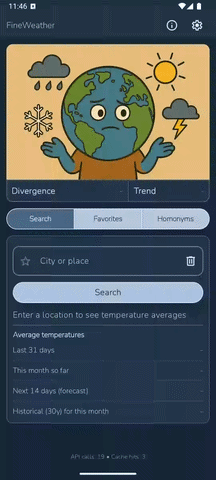

# FineWeather

FineWeather is an Android app that compares recent, forecast, and historic temperature averages for any city using Open-Meteo data.

## Features
- Search by city or place with geocoding, localized results, and alternate-match resolution for ambiguous names
- Average temperatures for the last 31 days, current month so far, and next 7 or 14 days
- Historical baseline (1961-1990 or current 30-year normal), always compared for the **same calendar days**, so a half-finished month is never measured against a whole one
- Divergence (this month so far vs. the baseline) and Trend (the coming days vs. normal for those same days) comparisons, plus a warning when current-month data is limited
- A plain-language summary next to the status illustration
- Three views: **Current** (the averages), **Month** (daily chart over the typical range with the forecast as a dashed line, for the month or the last 30 days) and **Year** (every month of the year so far against the baseline)
- Favorites for saving places locally (star next to the search bar) and reopening them from the list icon in the header; "Not your city?" switches between places with the same name
- Settings for forecast length, historic reference, search language, and divergence method
- Local caching: the 30-year baseline is stored once per place (least recently used places are evicted, favorites are kept), the current year's daily values and the 14-day forecast refresh once a day; settings live in DataStore. Data is complete up to yesterday

## Data sources
- Open-Meteo Forecast API, Archive API, and Geocoding API (no API key required). Weather data by [Open-Meteo.com](https://open-meteo.com/), licensed under CC BY 4.0; the free API is for non-commercial use.

## Tech stack
- Kotlin + Jetpack Compose (Material 3)
- MVVM with ViewModel + StateFlow
- Retrofit + Gson
- Room for caching and favorites
- DataStore Preferences for settings
- Coroutines

## Getting started
1. Open the project in Android Studio.
2. Ensure the Android SDK is installed (compileSdk 36, minSdk 27).
3. For CLI builds, use JDK 17 or newer (Android Studio's bundled JDK works).
4. Run the `app` configuration on an emulator or device.

### CLI builds
- `./gradlew assembleDebug`
- `./gradlew installDebug`

### Tests
- `./gradlew test`
- `./gradlew connectedAndroidTest`

## Settings
- Forecast length: 7 or 14 days
- Historic reference: 1961-1990 baseline or current 30-year normal ending at the last complete decade
- Search language: English, German, French, Spanish, Italian, Portuguese, Russian, Turkish, or Hindi
- Cache: shows how many locations and searches are cached and lets you clear them (favorites and settings are kept)
- Divergence method: absolute delta (raw °C difference) or normalized anomaly (standard deviations from baseline, to show how unusual the month is for that place)

## Project structure
- `app/src/main/java/com/example/fineweather/ui` Compose UI and screens
- `app/src/main/java/com/example/fineweather/viewmodels` UI state and business logic
- `app/src/main/java/com/example/fineweather/domain` pure climate logic (reference normals, comparisons, summary text), no Android dependencies
- `app/src/main/java/com/example/fineweather/data` repositories, models, and Room entities
- `app/src/main/java/com/example/fineweather/api` Open-Meteo Retrofit services
- `app/src/main/java/com/example/fineweather/utils` shared helpers used across layers

## Credits
- Illustrations generated with AI, inspired by the "This is Fine" meme by K.C. Green ([Gunshow #648](https://gunshowcomic.com/648))
- Development: hand-written from the start of the project (March 2025); agentic coding tools (Claude Code) used from mid-2026 onward for responsiveness fixes, the CI/release pipeline, test fixes, and cleanup
